# PayPal AI Hackathon

**PayPal AI Hackathon** is an AI-powered shared payments, bill splitting, and multi-currency wallet application. Users can scan receipts, split household or group expenses in natural language, send international transfers with two-way currency conversion, and complete per-person checkouts through PayPal Sandbox.

**Live Web App:** [paypal-hackathon-2026-git-main-dabomturtle8902-lang.vercel.app](https://paypal-hackathon-2026-git-main-dabomturtle8902-lang.vercel.app)

---

## Demo Videos

### Full Product Showcase (`1080p · 60 fps`)

[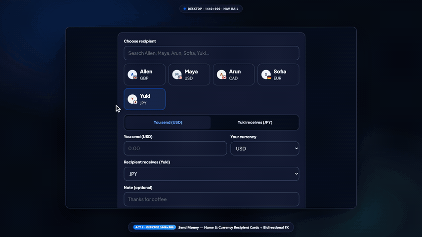](demos/splitsync-full-showcase.mp4)

> Click the preview above to watch [`demos/splitsync-full-showcase.mp4`](demos/splitsync-full-showcase.mp4) — end-to-end walkthrough across Desktop, Tablet, and Mobile covering PIN login, multi-currency transfers, Store checkout, Ask AI chat, receipt OCR, household bills, and PayPal Sandbox payments.

### Quick Walkthrough (`18.6s Highlight`)

[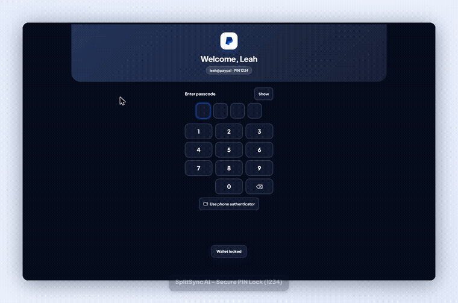](previews/splitsync-demo.mp4)

> Click above to watch [`previews/splitsync-demo.mp4`](previews/splitsync-demo.mp4) — fast highlight reel covering the 3D wallet cards, international GBP/USD conversion, and Ask AI group splitting.

---

## Key Features

### 1. Ask AI Chat & Voice Assistant
- **Natural-language money flows:** Type or dictate instructions (for example, sending money, ordering items from the Store, or splitting expenses across several friends at once).
- **Smart contact resolution:** When a name isn't recognized in your contacts, interactive confirmation cards let you pick the intended recipient, edit amounts and reasons inline, or tap saved contacts in one click.
- **Receipt-aware chat & voice replies:** Attach receipt images inside chat and listen to spoken confirmations synthesized with NVIDIA Chatterbox TTS.

### 2. AI Receipt Scanning (`Scan a Bill`)
- **Camera & image upload:** Capture a receipt live or upload PNG, JPEG, or WebP photos (automatically optimized before upload).
- **Structured extraction:** Extracts merchant name, date, currency, line items, and totals via multimodal vision AI, highlights unreadable fields or sum mismatches, and prepares split requests immediately.

### 3. Multi-Currency Wallet & International Transfers
- **6 supported currencies:** `USD`, `GBP`, `CAD`, `EUR`, `JPY`, and `INR`, backed by live/cached ECB exchange rates.
- **Two-way FX calculator:** Enter either the amount **you send** or the exact amount **your recipient receives**, with instant rate previews and clean currency formatting.
- **Flexible funding & 3D wallet:** Pay from your rechargeable **PayPal Wallet** or linked card, paired with an interactive 3D card deck on the Home Hub.

### 4. Group Bill Splitting & PayPal Sandbox Checkout
- **Equal or custom splits:** Divide restaurant bills, group purchases, electricity bills, and monthly rent equally or by per-person amounts, with optional saved rules for recurring monthly rent.
- **Isolated share links & QR codes:** Generate unique payment links and scannable QR codes per friend, complete checkout via **PayPal Sandbox Orders v2**, and track payment statuses (`Waiting for payment`, `Sent`, `Paid`) in real time.

### 5. AI Storefront & Activity Ledger
- **Household Store & Wallet checkout:** Browse 11 household items with category filters, manage cart quantities, pay directly, and send completed orders straight into Ask AI splitting (**Split cash**).
- **Activity & analytics:** View an inflow/outflow trend chart alongside filterable transaction history (`All`, `Awaiting payment`, `Payment received`, `Sent`, `Sandbox`).
- **Adaptive multi-device UI:** Responsive sidebar navigation on desktop/tablet, thumb-friendly bottom navigation on mobile, PIN lock protection (`1234`), `System / Light / Dark` theme modes, and a companion **Flutter** app.

---

## Screenshots

| Desktop Home (`1440×900`) | Desktop Ask AI (`1440×900`) | Desktop Activity Cycle |
| :---: | :---: | :---: |
| 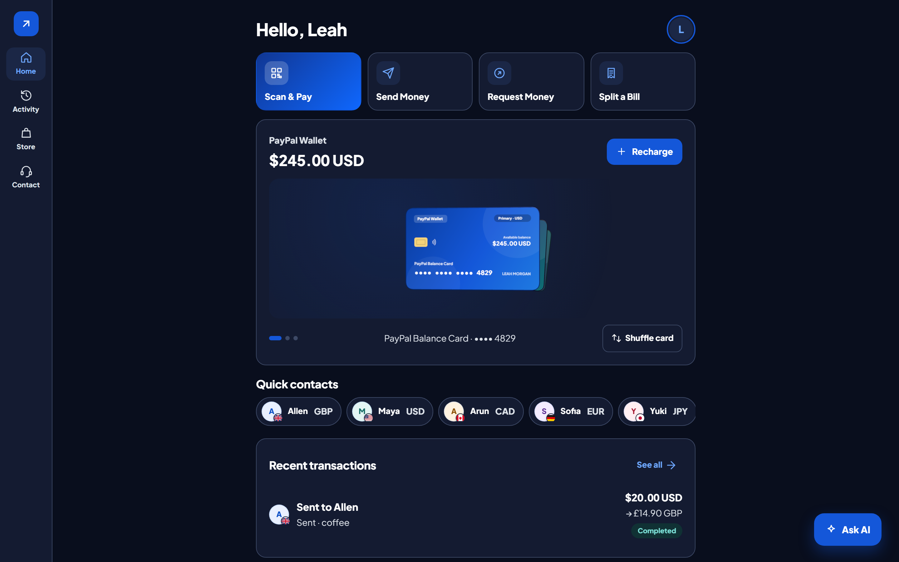 | 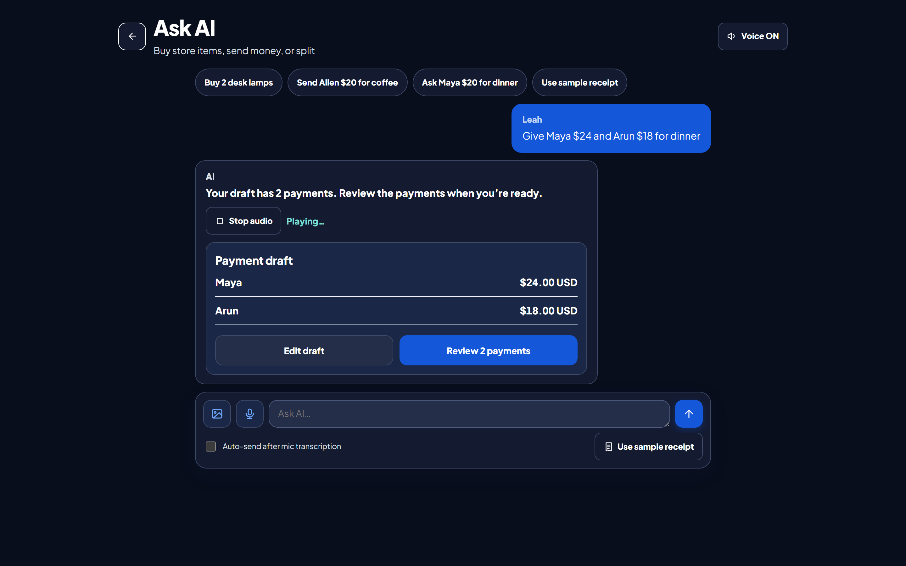 | 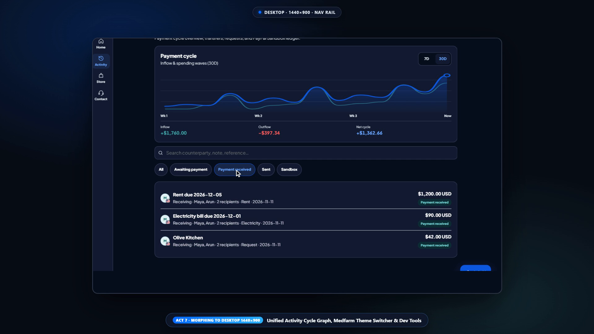 |

| Tablet Storefront (`1024×768`) | Mobile PIN Login (`390×844`) | Mobile Send Money (`390×844`) |
| :---: | :---: | :---: |
| 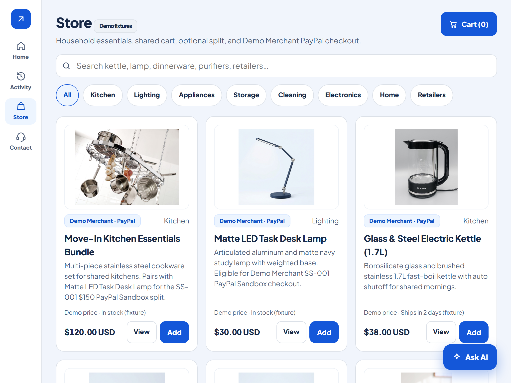 | 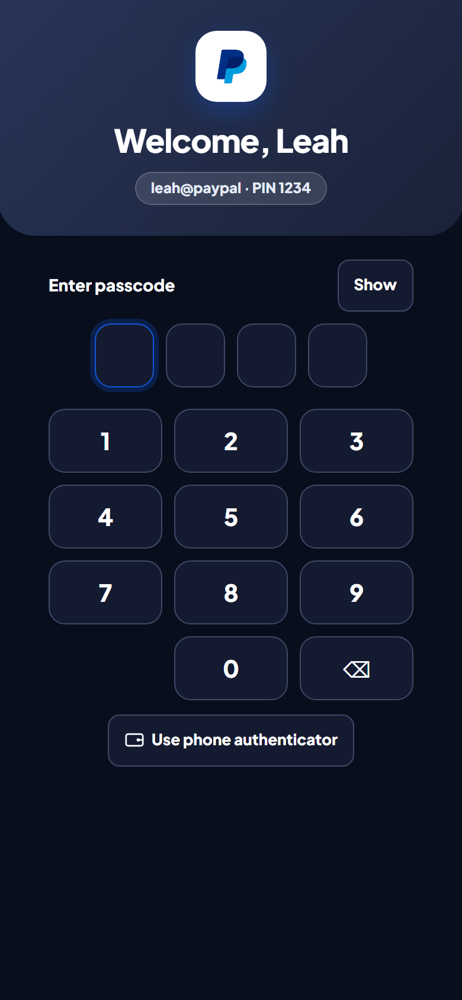 | 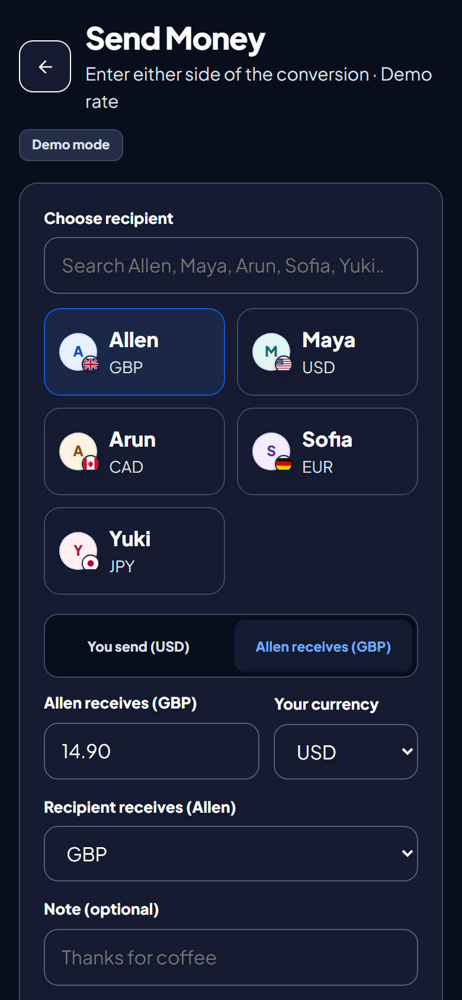 |

| Phone Receipt Split | Phone Household Bills | Phone Payer Checkout | Flutter App (`390×844`) |
| :---: | :---: | :---: | :---: |
| 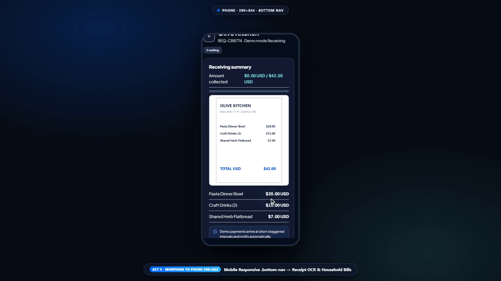 | 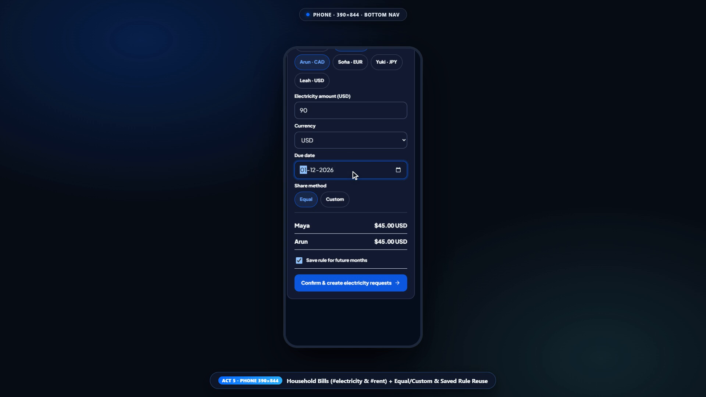 | 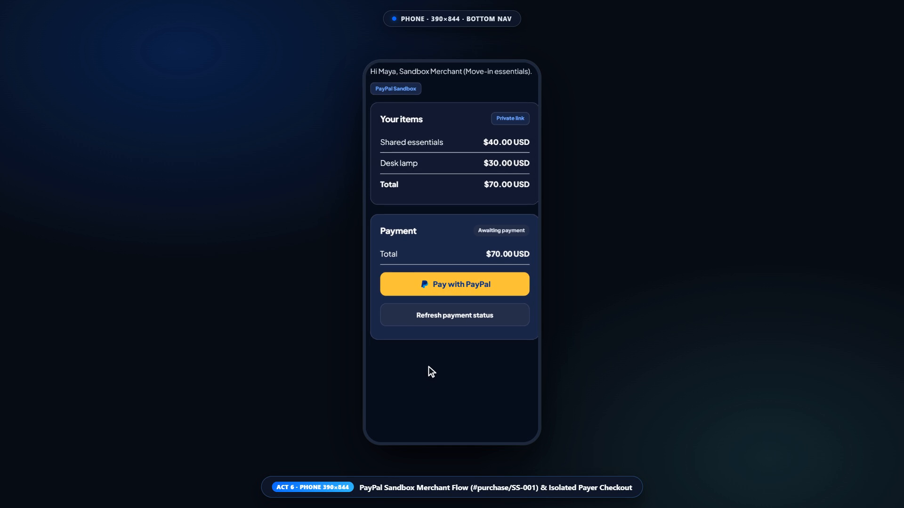 | 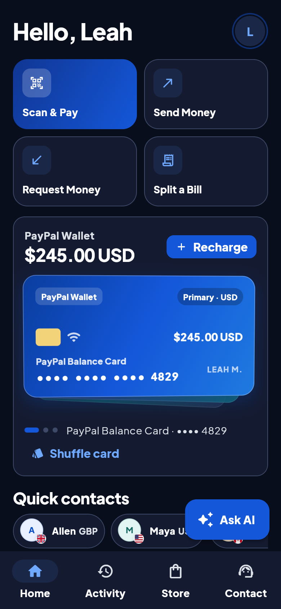 |

---

## Project Structure

```text
PayPal_Hackathon_2026/
├── website/dist/          # Responsive Web App (HTML, CSS, Vanilla JS, Three.js 3D cards, QR generator)
├── website/test/demo.cjs  # Automated web UI, FX, Ask AI, and Store verification script
├── api/index.mjs          # Vercel serverless API entrypoint
├── vercel.json            # Vercel static hosting and API route rewrites
├── server/                # Zero-dependency Node.js 22+ API server, PayPal Sandbox client & NVIDIA AI/TTS integration
│   └── test/              # Node test suite (28 unit & integration tests)
├── flutter_app/           # Companion cross-platform Flutter application & widget tests
├── demos/                 # Full 1080p showcase recording (splitsync-full-showcase.mp4)
└── previews/              # Multi-device screenshots and animated GIF/MP4 previews
```

---

## Quick Start

### 1. Run Locally (Web App + Node.js Backend)

Requires **Node.js 22+**.

```bash
cd server
cp -n .env.example .env   # optional: add PayPal Sandbox & NVIDIA API keys
npm start
```

Open **`http://localhost:3000`** in your browser (default demo PIN: **`1234`**). See [`server/README.md`](server/README.md) for PayPal Sandbox, webhook, and environment variable setup.

### 2. Run the Companion Flutter App

```bash
cd flutter_app
flutter pub get
flutter run -d chrome --web-port=5173 --dart-define=PAYER_ORIGIN=http://localhost:3000
```

---

## Verification

| Check | Command |
| :--- | :--- |
| **Web App Suite** | `node website/test/demo.cjs` |
| **Backend Tests (`28` tests)** | `cd server && npm test` |
| **Flutter Static Analysis** | `cd flutter_app && flutter analyze` |
| **Flutter Widget Tests** | `cd flutter_app && flutter test --no-pub` |
