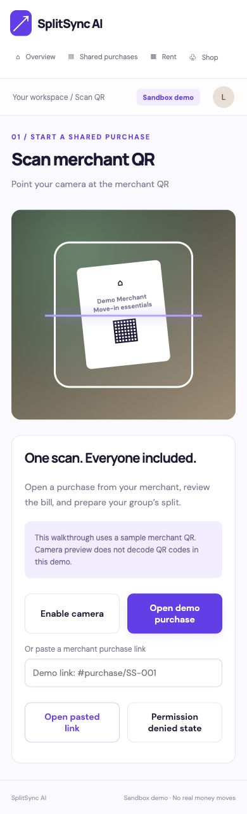
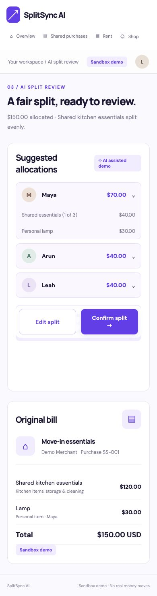
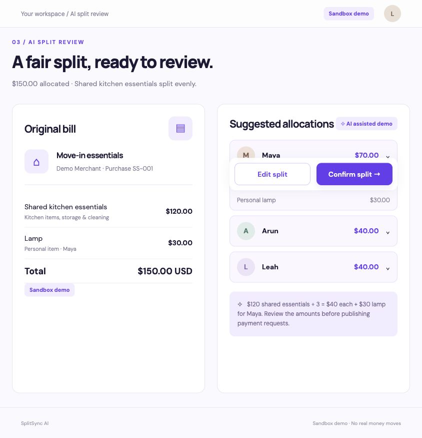
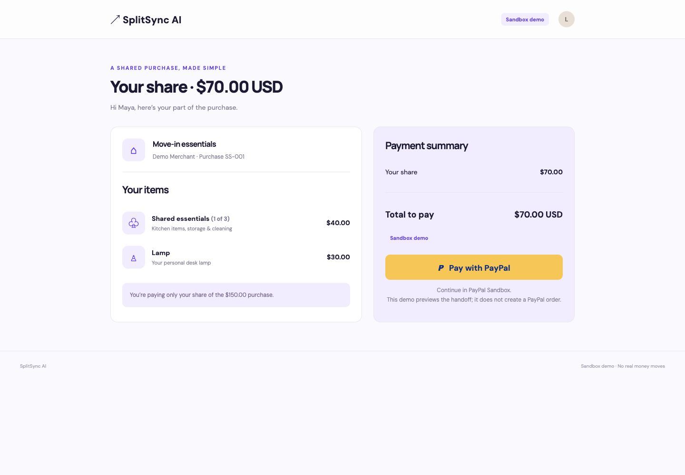
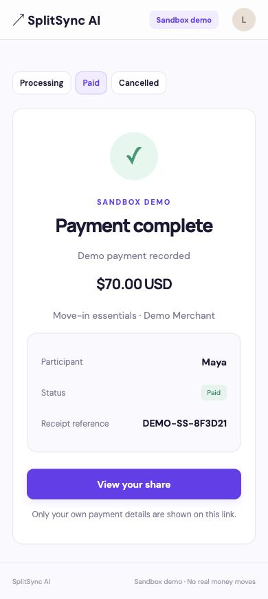

# SplitSync AI

Two coordinated implementations of the attached SplitSync mockups: a responsive website and a Flutter mobile application. Purple #683CF0, warm white, lavender cards, navy type, and a distinct PayPal yellow handoff. Medfarm assets were not available.

## Website

Serve `website/dist` with any static web server, for example `python3 -m http.server 8080 --directory website/dist`.

Routes: `#welcome`, `#home`, `#scan`, `#scan-error`, `#review`, `#clarify`, `#split`, `#edit`, `#requests`, `#qr/maya`, `#dashboard`, `#share/maya`, `#handoff/maya`, `#result/maya/processing`, `#result/maya/paid`, `#result/maya/cancelled`, `#rent`, `#preferences`, `#shop`, `#product`. Replace maya with arun or leah on participant routes.

Desktop and mobile layouts share components. Scanner, split review and group status use two columns at wider widths. Camera needs HTTPS or localhost; website scanning provides a live preview and pasted demo-link validation, rather than a QR decoder. Generated participant QRs encode the corresponding share link.

## Flutter

Install current stable Flutter, then from `flutter_app`:

```sh
flutter create --platforms=android,ios,web --project-name splitsync .
flutter pub get
flutter analyze
flutter run --dart-define=PAYER_ORIGIN=https://YOUR_SITE_ORIGIN
```

`PAYER_ORIGIN` defaults to the published demo website. Use an origin without a trailing slash. The native app includes real camera QR decoding through mobile_scanner. Add `NSCameraUsageDescription` to `ios/Runner/Info.plist` with a description such as “Scan merchant purchase QR codes”. Verify Android camera permission and Internet permission in the generated manifest. Use HTTPS and an accessible website origin for sharing across devices.

Flutter/Dart are unavailable in the creation environment: the Dart source has not been compiled or run. Native platform directories must be generated by `flutter create` above. Dependency constraints must be resolved and analysis run on a Flutter-equipped machine.

## Demo boundaries

- Sample purchase: kitchen $120 + lamp $30 = $150. Maya $70, Arun $40, Leah $40 by default. Editing lamp owner recalculates totals.
- AI allocation is a deterministic demo rule, not a model API. The clarification screen lets the organizer select lamp ownership.
- Website preferences and lamp selection persist locally; Flutter state lasts for the current app session.
- Demo organizer entry does not authenticate. Participant hash URLs are not private authorization tokens. Organizer and participant views have separate layouts, but are not secured against access.
- Group ledger is seeded with Maya Paid, Arun Processing, Leah Awaiting payment. Result previews do not mutate that ledger or assert a real provider confirmation.
- PayPal is a distinct storyboard step, not a working payment integration. No credentials are collected, no orders created and no money moves. Production needs server-side Sandbox order creation/capture, PayPal-owned approval redirect, verified webhooks, idempotency, and secured participant tokens before payments can be enabled.
- Rent and shop are later-workflow demos. Rent review acknowledges a sample draft. The demo kitchen bundle opens the existing bill; retailer links open IKEA.
- Website loads optional Google Fonts with system fallbacks. QR generation library is vendored locally under its MIT license.

## Demo screenshots

These screenshots show the responsive website demo. The Flutter source implements the companion mobile flow; native builds have not been validated.

### Scan a purchase


### Review the split



### Open a participant payment request


### Preview a payment result

