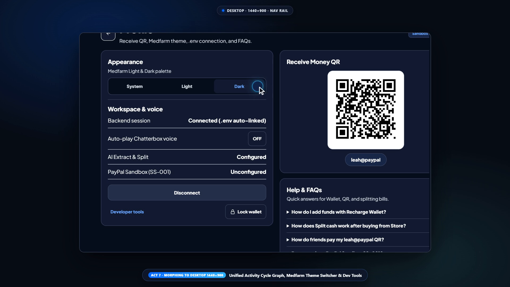

# SplitSync AI

**Multi-currency wallet, AI-assisted group bill splitting, receipt OCR, household recurring bills, and PayPal Sandbox merchant checkout** — built across a responsive **Vanilla JS Web App** (`website/dist/`), a **Flutter App** (`flutter_app/`), and a **Node.js Backend** (`server/`).

[](demos/splitsync-full-showcase.mp4)
[](#testing--verification)
[](#testing--verification)
[](#testing--verification)

---

## Live 7-Act Product Showcase

Click the animated preview below to open the full 1080p 60fps showcase recording ([`demos/splitsync-full-showcase.mp4`](demos/splitsync-full-showcase.mp4)):

[](demos/splitsync-full-showcase.mp4)

> **Video specs:** `1920×1080` · `60 fps` · `H.264 (yuv420p)` · `146.97s` (`8,818` frames) · `18.9 MB`
> Recorded deterministically across live **Desktop (`1440×900`) -> Tablet (`1024×768`) -> Phone (`390×844`)** bezel morphs via [`scripts/record-splitsync-showcase.mjs`](scripts/record-splitsync-showcase.mjs) (Playwright + Chrome DevTools Protocol `Emulation.setDeviceMetricsOverride` + FFmpeg).

<details>
<summary><strong>7-Act Showcase Breakdown (Click to expand)</strong></summary>

1. **Act 1 — Authentication & Core Home Shell (`Desktop 1440×900 · .nav-rail`):** PIN lock (`"Welcome, Leah"` / `1234`) with Show/Hide toggle and Phone Authenticator unlock, organizer connection state (`#welcome`), PayPal Wallet (`$245.00 USD`) + Three.js 3D card deck (`cards3d.js`) + `+ Recharge` modal, Quick Contacts, Bento Store showcase, and `leah@paypal` Receive QR.
2. **Act 2 — Bidirectional International FX & Transfers (`Desktop 1440×900`):** Currency-only recipient cards (`Allen · GBP`, `Maya · USD`, `Arun · CAD`, `Sofia · EUR`, `Yuki · JPY`), `You send` vs `Recipient receives` toggle with integer `JPY` formatting and live `INR` estimates, funding source selection (`PayPal Wallet` vs `PayPal Cashback •••• 9104`), and `#tx/:id` receipt.
3. **Act 3 — Store, Cart, Checkout & "Split Cash" AI Handoff (`Tablet 1024×768 · Adaptive`):** `11`-item household catalog with category chips (`All`, `Kitchen`, `Lighting`, `Electronics`), product detail (`#product/:id`) quantity stepper & sandbox badge, `#cart`, `#checkout-review`, and Store Receipt **Split cash** handoff straight into Ask AI.
4. **Act 4 — Multimodal Ask AI, Voice TTS & Group Payment Drafts (`Tablet 1024×768`):** `#ask` (`#fab-ask-ai`) with `Voice ON/OFF` Chatterbox TTS toggle, multi-recipient batch split prompt (`"Give Maya $24 and Arun $18"`), ambiguous contact clarification, `#review-payment-draft`, and `#payment-draft-receipt`.
5. **Act 5 — Receipt Scanning & Household Bills (`Phone 390×844 · .bottom-nav`):** Responsive bottom navigation, `#scan-bill` (`Olive Kitchen` OCR sample receipt, editable line items, mismatch warning), `#request/:id` progress & staggered arrival notifications, and `#electricity` / `#rent` Equal vs Custom shares with `Save rule for future months`.
6. **Act 6 — PayPal Sandbox Merchant Flow (`SS-001`) & Isolated Payer Views (`Phone 390×844`):** `#scan` QR scanner -> `#purchase/SS-001` -> `#review` -> `#split` (`$150.00 USD`: `$120` shared essentials + `$30` desk lamp owner chip), `#requests`, `#qr/:name`, `#pay/:token` (`Pay with PayPal` Orders v2 Sandbox), and `#dashboard`.
7. **Act 7 — Unified Activity Ledger, Theme Switcher & Dev Tools (`Desktop 1440×900`):** `#activity` (`#payment-cycle-card` 7D/30D inflow/outflow wave + `All` / `Awaiting payment` / `Payment received` / `Sent` / `Sandbox` filters), `#profile` (Medfarm `System / Light / Dark` theme switcher, backend/Chatterbox/Sandbox status, enlarged `leah@paypal` QR), and `#dev` controls.

</details>

---

## Multi-Device Screenshots

### Screen Studio Showcase Captures (Latest Web Flow)

| Desktop Activity Cycle (`1440×900`) | Desktop Profile, Theme & QR (`1440×900`) |
| :---: | :---: |
|  |  |

| Phone Receipt Split (`390×844`) | Phone Household Bills (`390×844`) | Phone Payer Checkout (`390×844`) |
| :---: | :---: | :---: |
|  |  |  |

### Native Web & Flutter Viewport Captures

| Desktop Home (`1440×900`) | Desktop Ask AI (`1440×900`) | Tablet Storefront Light (`1024×768`) |
| :---: | :---: | :---: |
|  |  |  |

| Mobile PIN Login (`390×844`) | Mobile Send Money (`390×844`) | Flutter Home (`390×844`) |
| :---: | :---: | :---: |
|  |  |  |

---

## Core Features

- **Medfarm Light & Dark Adaptive UI:** Responsive navigation rail on desktop/tablet (`.nav-rail`) transitioning seamlessly into a thumb-friendly mobile `.bottom-nav`, paired with `System / Light / Dark` theme switching and an interactive Three.js 3D PayPal card deck (`website/dist/cards3d.js`).
- **Bidirectional FX & Cross-Border Transfers:** Switch freely between `You send` and `Recipient receives`, format integer `JPY` amounts cleanly, preview `Demo rate` + `INR` estimates, and choose between `PayPal Wallet` and `PayPal Cashback •••• 9104` at checkout.
- **Ask AI Assistant & Voice TTS:** Parse natural-language split instructions (`"Give Maya $24 and Arun $18"`), disambiguate contacts interactively, confirm multi-recipient Group Payment Drafts, and toggle Chatterbox TTS audio playback (`server/chatterbox.py`).
- **Receipt OCR & Household Bills:** Scan or load sample receipts with editable line items and mismatch detection (`#scan-bill`), plus recurring Electricity (`#electricity`) and Rent (`#rent`) workflows with Equal vs Custom share rules and `Save rule for future months`.
- **Store Catalog & "Split Cash" Handoff:** Browse 11 household items with category filtering, adjust cart quantities, complete demo checkout, and send the receipt straight to `#ask` via **Split cash**.
- **PayPal Sandbox Orders v2 Merchant Flow (`SS-001`):** Generate isolated per-participant payer checkout links (`#pay/:token`) backed by `server/paypal.mjs` with live collection progress tracking (`#dashboard`).

---

## Project Structure

```text
SplitSync-AI/
├── website/
│   ├── dist/                # Responsive Web App (index.html, app.js, cards3d.js, qrcode.js, style.css, three.module.min.js)
│   └── test/demo.cjs        # VM UI route, FX, QR, and store verification suite
├── server/
│   ├── app.mjs              # Node.js 22+ HTTP API (no npm dependencies), static hosting, SSE events & purchase store
│   ├── paypal.mjs           # PayPal Sandbox Orders v2 client & webhook verification
│   ├── nvidia.mjs           # Multimodal AI receipt extraction & split parser
│   ├── chatterbox.py        # Voice TTS synthesis helper
│   ├── transcribe.py        # Speech transcription helper
│   ├── README.md            # Sandbox credentials, organizer access, Flutter CORS, and webhooks guide
│   └── test/                # Node native test runner suite (25 unit & integration tests)
├── flutter_app/
│   ├── lib/                 # Cross-platform Flutter UI, models, theme, widgets & speech helpers
│   └── test/widget_test.dart # 15 Flutter widget & flow tests
├── scripts/
│   └── record-splitsync-showcase.mjs  # 7-Act Screen Studio Playwright + CDP + FFmpeg recorder
├── demos/
│   └── splitsync-full-showcase.mp4    # Full 1920×1080 60fps H.264 showcase video
└── previews/                # Multi-device screenshots & splitsync-showcase.gif preview
```

---

## Quick Start

### 1. Run the Backend & Web App

Requires **Node.js 22+** (no npm dependencies in `server/`). See [`server/README.md`](server/README.md) for PayPal Sandbox credentials, organizer access keys, and webhook setup.

```bash
cd server
cp -n .env.example .env   # optional: configure PayPal Sandbox / NVIDIA / LOCAL_ORGANIZER_AUTO_LOGIN
npm start
```

Open **`http://localhost:3000`** in your browser (`Profile → Connect backend` accepts the organizer key printed in the server terminal, or set `LOCAL_ORGANIZER_AUTO_LOGIN=true` in `server/.env` for automatic local demo access; default demo PIN is `1234`).

### 2. Run the Flutter App

```bash
cd flutter_app
flutter pub get
flutter run -d chrome --web-port=5173 --dart-define=PAYER_ORIGIN=http://localhost:3000
```

### 3. Re-Record the 7-Act Product Demo Video

Requires Node.js dependencies in `scripts/` (`Playwright`) and `ffmpeg`/`ffprobe` on `PATH`:

```bash
cd scripts && npm install && cd ..
node scripts/record-splitsync-showcase.mjs
# Fast choreography check (dry-run without video encode):
node scripts/record-splitsync-showcase.mjs --dry-run
```

---

## Testing & Verification

| Target | Command | Observed Result |
| :--- | :--- | :--- |
| **Web UI & Routes** | `node website/test/demo.cjs` | **PASS** (exit `0`) |
| **Node Server** | `cd server && npm test` | **25 passed**, `0` failed |
| **Flutter Analysis** | `cd flutter_app && flutter analyze` | **PASS** (no issues) |
| **Flutter Tests** | `cd flutter_app && flutter test --no-pub` | **15 passed**, `0` failed |
